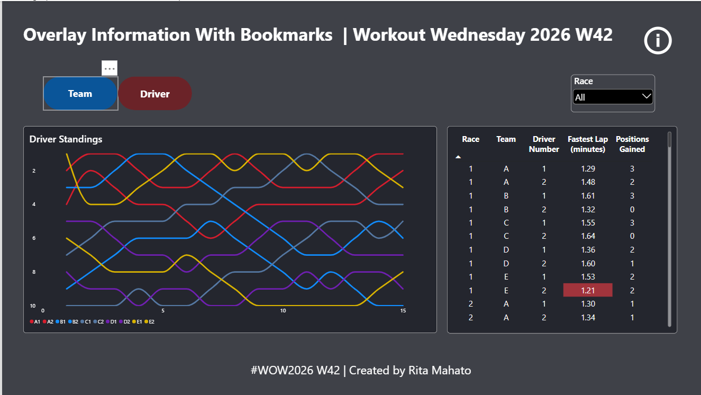
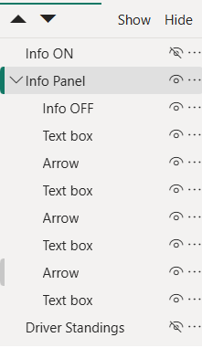

# 📊 [Project Title] – Power BI Dashboard

A minimal Power BI dashboard for motorsport fans and report users, with a bookmark-powered info panel that explains how to read and use the report.

🔗 **Live Dashboard:** [Publish to web link]
🎥 **Walkthrough:** [YouTube/LinkedIn link, optional]



## 🎯 Business Problem
Users often open a report and don't know what a chart shows, what a filter does, or where to start.
This dashboard solves that with a bookmark-driven info panel that turns the page into on-screen instructions, so viewers can read the standings with confidence and no outside explanation.

## 📁 Dataset
- **Source:** Motorsports mock data (sample dataset provided for the Power BI challenge). 
Data for this challenge can be obtained from GitHub.
https://github.com/Imba456/Workout-Wednesday-for-Power-BI/blob/main/datasets/Motorsports%20Mock%20Data.xlsx
- **Size:** 1 table (`Standings`), 150 rows × 8 columns, covering Races 1–15 (no calendar dates)
- **Key fields:** Race, Team, Team Standings, Driver ID, Driver Number, Driver Standings, Fastest Lap (minutes), Positions Gained

## 🔍 Key Insights
1. **Team A dominated the championship.** It finished first in 8 of 15 races and had the best average team standing (1.53). Team B (4 wins) and Team C (2 wins) came next.
2. **One driver carried Team E.** E2 won 7 races and had the best average finish (1.93), but E1 averaged 8.53. Team E's own standing was best in Race 1 and only 2.67 on average, so one star driver wasn't enough to lead.
3. **Team A was the most consistent.** A1 finished on the podium in all 15 races (average finish 2.00). A1 and E2 were the only drivers averaging in the top 2.
4. **Speed tracks results.** E2 set the fastest lap of the season (0.88 min in Race 12) and had the best average lap time (1.21 min). Fastest-lap time and finishing position are strongly correlated (r = 0.66).
5. **Backmarkers gained the most places.** Team D had the highest total positions gained (62) but the worst average standing (4.47). Driver D1 gained the most places individually (42). Gaining places didn't turn into wins.

## ✨ Dashboard Features
- **Race slicer** to filter the page to a single race or a range of races
- **Two chart views in one space.** Buttons switch between *Team Standing* and *Driver Standings* line charts (race on the x-axis, rank on an inverted y-axis so 1st place sits at the top)
- **Driver detail table** showing Driver Number, Fastest Lap (minutes) and Positions Gained for each race and team
- **Info ON/OFF button** using bookmarks. The info button turns the page into an overlay of instructions, and the close button returns to the dashboard
- **Custom report-page tooltip** ("Race Tooltip") showing each driver's fastest lap per race on hover
- **Custom DAX measure:** `Fastest Lap per Race`



## 🧮 Key DAX Measures
```DAX
Fastest Lap per Race = 
MIN ( Standings[Fastest Lap (minutes)] )

Fastest Lap per Race (All Drivers) = 
CALCULATE (
    MIN ( Standings[Fastest Lap (minutes)] ),
    ALLEXCEPT ( Standings, Standings[Race] )
)

Is Fastest Lap = 
IF (
    MIN ( Standings[Fastest Lap (minutes)] ) = [Fastest Lap per Race (All Drivers)],
    1,
    0
)
```

## 🛠️ Tools Used
Power BI Desktop · DAX · Power Query 

## 🚀 How to Use
1. Download `dashboard/project-name.pbix`.
2. Open it in Power BI Desktop.
3. If prompted, update the data source path to your local `data/` folder.

## 📬 Connect
**Rita Mahato** – Data Analyst
[LinkedIn]https://www.linkedin.com/in/mahato-rita/ · [Portfolio]https://codebasics.io/portfolio/Rita-Mahato · [Email](mailto:ds.rita.mahato@gmail.com)